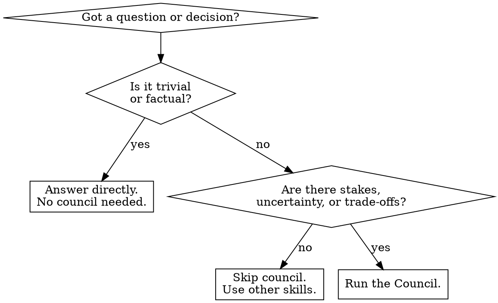

# LLM Council

Run any question, idea, or decision through 5 independent advisors, blind peer review, and a chairman verdict. Produces a structured decision with clear action.

**Core principle:** Five perspectives challenge each other before you commit. No echo chamber.

## When to Use



- **Use:** Decisions with trade-offs, strategy questions, "should I..." dilemmas, idea validation
- **Don't use:** Factual queries, simple implementation tasks, questions with one clear answer

## The Five Advisors

| Advisor | Role | Core Question |
|---------|------|---------------|
| **Скептик (Contrarian)** | Actively finds flaws, risks, what will break | "What's the fatal flaw?" |
| **Мыслитель с нуля (First Principles)** | Strips assumptions, reframes the core problem | "What problem are we actually solving?" |
| **Оптимист (Expansionist)** | Finds hidden upside, adjacent opportunities | "What if this works even better than expected?" |
| **Аутсайдер (Outsider)** | Fresh eyes — catches curse of knowledge | "What's obvious to a beginner but invisible to an expert?" |
| **Исполнитель (Executor)** | Only cares about actionable next steps | "What do we do Monday morning?" |

Natural tensions: Contrarian ↔ Expansionist, First Principles ↔ Executor, Outsider keeps everyone honest.

## Council Session — 4 Steps

### Step 1: Frame the Question

Take the raw user question and reformulate it into a clear, neutral prompt that all 5 advisors will receive. Include:

- **Essence of the decision** — what's actually being decided
- **Key context** — relevant constraints, stakes, timeline
- **What's at stake** — what happens if wrong

**MANDATORY:** Write the framed question to a file `.claude/council-question.md` using the Write tool. Do NOT skip this. Show the framed question to the user before proceeding to Step 2.

**Do NOT editorialize.** The question must be neutral — no leading phrasing toward any outcome.

**Language:** Respond in the same language the user used. If they wrote in Russian, the council deliberates in Russian.

### Step 2: Convene the Council (5 parallel subagents)

Spawn all 5 advisors as **5 separate Agent tool calls in a single message block**. This is critical for independence — each advisor must be a distinct subagent that cannot see other advisors' responses.

**How to spawn:** In one response, make 5 parallel Agent tool calls. Each subagent receives:
1. The framed question (from Step 1)
2. Their specific role and core question
3. Instruction to respond in 150–300 words with no hedging

**Example prompt for each subagent:**
```
You are the [ROLE NAME]. [Role description]. Core question: "[CORE QUESTION]".

Respond to the following decision in 150-300 words. Take a strong position — no hedging, no "on the other hand." Be specific.

[FRAMED QUESTION]
```

**Each advisor must:**
- Fully inhabit their role — no hedging, no "on the other hand"
- Be specific, not vague — name concrete risks, opportunities, steps
- Stay within 150–300 words
- Not read other advisors' responses (separate subagents = natural isolation)

**CRITICAL:** Do NOT generate all 5 responses in your own context. Do NOT write advisor responses yourself. Each advisor MUST be a separate Agent tool call. Generating all responses inline destroys independence — later advisors will be influenced by earlier ones within the same context window.

### Step 3: Blind Peer Review (5 parallel subagents)

Collect the 5 advisor responses from Step 2. Assign each a random label (Ответ А, Б, В, Г, Д) — **shuffle the mapping so role labels don't map predictably** (e.g., don't always put Скептик as А).

Spawn 5 peer reviewers as **5 separate Agent tool calls in a single message block**. Each reviewer receives ONLY the 5 anonymized responses (no role labels, no advisor names) and answers:

1. **Какой ответ самый сильный и почему?** — Which response is strongest and why?
2. **В каком ответе самое слепое пятно?** — Which response has the biggest blind spot, and what's missing?
3. **Что ВСЕ ответы упустили?** — What did ALL responses miss that the Council should consider?

**Each reviewer must:**
- Evaluate based on content alone — they do NOT know which advisor wrote which response
- Quote specific passages when citing strengths or weaknesses
- Identify gaps that ALL responses missed, not just individual ones

**CRITICAL:** Do NOT tell reviewers which response came from which advisor. The anonymization must be real, not performative. If a reviewer can guess "this sounds like the Contrarian," that's fine — but you must NOT supply the mapping.

### Step 4: Chairman Verdict

You (acting as Chairman) receive everything: original question, all 5 advisor responses, and all 5 peer reviews. Produce the verdict in this exact structure:

## ВЕРДИКТ СОВЕТА

### Где Совет согласен
(Points where multiple advisors converged independently. High-confidence signals.)

### Где Совет спорит
(Genuine disagreements. Present both sides. Explain why reasonable advisors disagree.)

### Слепые зоны, которые поймал Совет
(Things that surfaced only during peer review. What individual advisors missed but others caught.)

### Рекомендация
(One clear, actionable recommendation. Not "it depends." Not a list. One direction, one answer.)

### ОДНО дело, которое нужно сделать первым
(One specific next step. ONE thing — not "1. ... 2. ... 3. ...". If you write a list, delete it and pick the single most important action.)

## Red Flags — STOP and Restart

| Red Flag | Reality |
|----------|---------|
| "I'll summarize all perspectives in one response" | Must spawn 5 separate subagents via Agent tool. Independence is non-negotiable. Generating all inline = contamination. |
| "I'll write all advisor responses myself" | No. Each advisor MUST be a separate Agent tool call. Writing them yourself means later advisors are influenced by earlier ones. |
| "The answers are similar enough to combine" | Peer review is mandatory. No skipping. |
| "I'll anonymize mentally" | Actual anonymization with shuffled labels. Otherwise review is biased. |
| "A quick verdict will do" | Verdict must follow the exact 5-section structure. |
| "This question is too simple for a full council" | If you invoked the council, run the full council. If it's truly trivial, don't invoke it. |
| "Parallel is overkill here" | Sequential = contaminated. Always parallel. |
| "I'll skip framing and go straight to advisors" | Step 1 is mandatory. Poor framing = poor council. |
| "I'll just give a list of next steps" | ONE next step. Not two. Not five. One. |

**Violating any of these means restart the entire council session.**

## Common Mistakes

| Mistake | Fix |
|---------|-----|
| Advisors hedge or play it safe | Re-spawn with explicit instruction: "Take a strong position. No hedging." |
| Peer review is superficial | Require specific citations: "Quote the exact passage that's strongest/weakest." |
| Verdict is vague ("consider both options") | Chairman must pick ONE direction. "It depends" is not a verdict. |
| Recommendation is a multi-paragraph essay before the ONE thing | Recommendation = ONE sentence giving direction. Details go in agreement/disagreement sections. |
| Question framing is leading | Rewrite without editorializing. Remove "obviously", "clearly", any directional language. |
| Advisors are too short (<100 words) | Each advisor needs 150–300 words of substance. Re-spawn if shallow. |